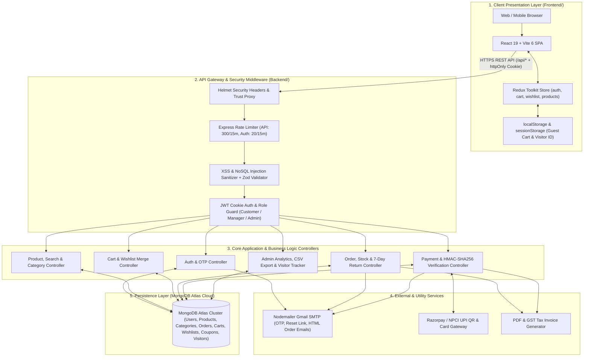
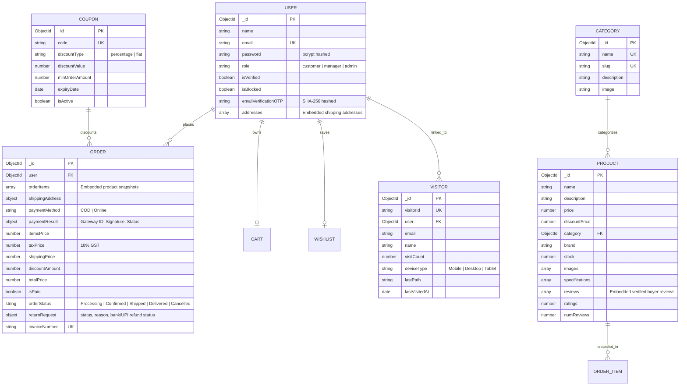
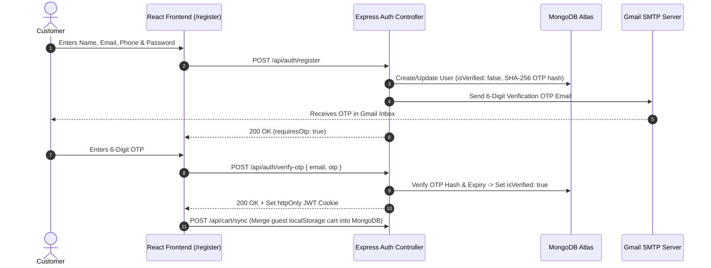
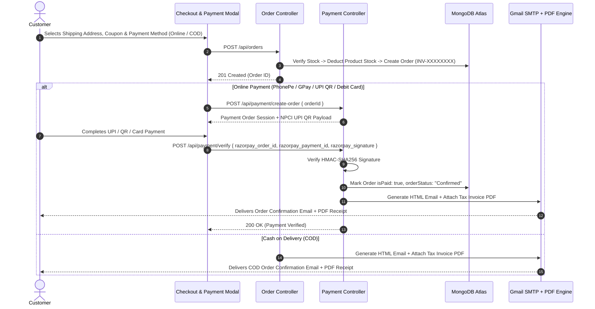
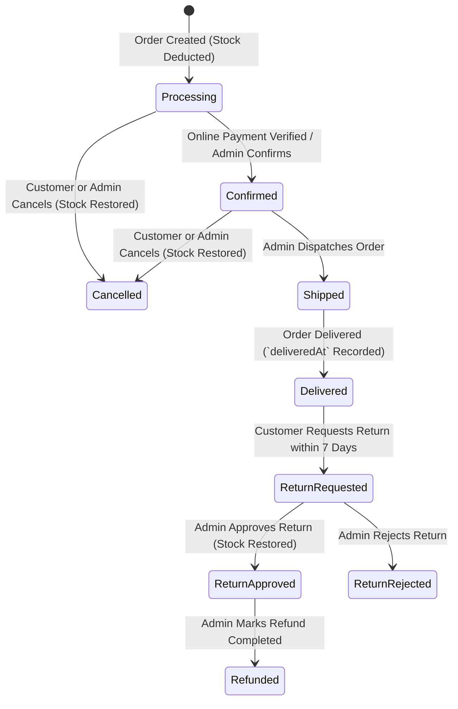

# 🏗️ ShopEase — Complete System Design & Architecture

**Project:** ShopEase — Full-Stack MERN E-Commerce Platform  
**Live Deployment:** [https://shopease-jiz6.onrender.com](https://shopease-jiz6.onrender.com)  
**Author:** Nisha Nishad (`@snishanishad`)

---

## 1. High-Level System Architecture (HLD)

ShopEase follows a **3-Tier Layered Client-Server Architecture** deployed as a unified Cloud Web Service on **Render** connected to a distributed **MongoDB Atlas** cluster.

---

## 2. Database Schema & Entity-Relationship (ER) Diagram

MongoDB schemas are designed using **normalized references (`ObjectId`)** for high-cardinality entities (`Users`, `Products`, `Categories`) and **embedded subdocuments** for immutable snapshots (`orderItems`, `shippingAddress`, `reviews`, `returnRequest`).

---

## 3. Core Workflow Sequence Diagrams

### 3.1 Registration with 6-Digit Email OTP & JWT Cookie Authentication

---

### 3.2 Checkout, Online Payment (UPI / QR / Card) & Rich HTML + PDF Invoice Flow

---

## 4. Order & 7-Day Return/Refund State Machine

---

## 5. Key Architectural & Engineering Decisions (Interview Highlights)

| Area | Design Choice | Why It Matters |
| :--- | :--- | :--- |
| **Authentication** | `httpOnly`, `Secure`, `SameSite` JWT Cookies | Prevents JavaScript XSS token theft compared to storing raw JWTs in `localStorage`. |
| **Hybrid Cart Architecture** | Guest `localStorage` + Authenticated MongoDB Merge (`/api/cart/sync`) | Allows unauthenticated visitors to shop without friction and merges their cart automatically upon login. |
| **Inventory Consistency** | Atomic Stock Validation & Automatic Stock Restoration | Deducts stock at order creation and automatically restores stock if an order is cancelled or a return is approved. |
| **Verified Buyer Reviews** | Order-History Verification (`orderStatus !== 'Cancelled'`) | Only customers who actually purchased the product can submit a rating/review, preventing fake reviews. |
| **Security Defense-in-Depth** | Zod Schema Validation + Custom NoSQL/XSS Sanitizer + Rate Limiting | Blocks malformed payloads, `$gt`/`$ne` MongoDB operator injection, `<script>` injection, and brute-force attacks. |
| **Performance Optimization** | React `lazy()` + `Suspense` Code Splitting & MongoDB Compound Indexes | Splits route bundles (Admin, Checkout, ProductDetail) for fast initial load and fast catalog filtering. |
