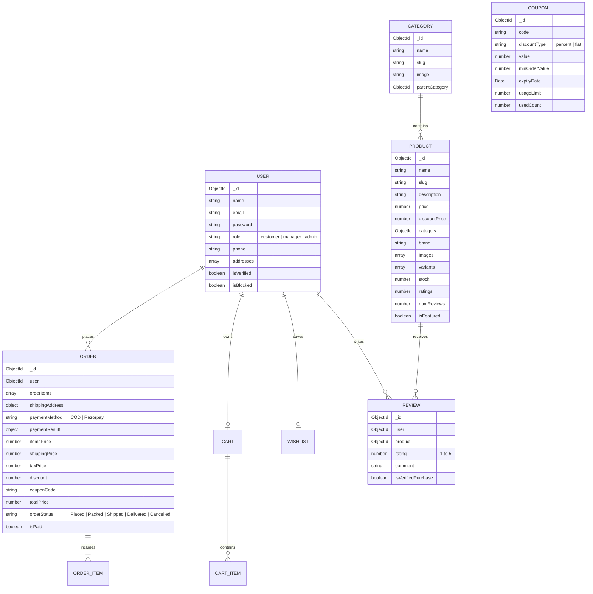

# ShopEase — Database ER Diagram & Complete REST API Reference

## 1. Entity-Relationship (ER) Diagram (Mermaid)

---

## 2. REST API Endpoints Reference

| Module | Method | Endpoint | Access | Description |
| :--- | :--- | :--- | :--- | :--- |
| **Auth** | `POST` | `/api/auth/register` | Public | Register user & set `httpOnly` JWT cookie |
| **Auth** | `POST` | `/api/auth/login` | Public | Login user & set `httpOnly` JWT cookie |
| **Auth** | `POST` | `/api/auth/logout` | Public | Clear `httpOnly` JWT cookie |
| **Auth** | `GET` | `/api/auth/me` | Private | Get current logged-in user profile |
| **Auth** | `PUT` | `/api/auth/profile` | Private | Update name, phone, and saved addresses |
| **Auth** | `PUT` | `/api/auth/password` | Private | Change account password |
| **Auth** | `POST` | `/api/auth/forgot-password` | Public | Generate 15-min SHA-256 reset token & email |
| **Auth** | `PUT` | `/api/auth/reset-password/:token` | Public | Reset password with valid token |
| **Categories** | `GET` | `/api/categories` | Public | List all categories |
| **Categories** | `POST` | `/api/categories` | Admin/Manager | Create a new category |
| **Categories** | `DELETE` | `/api/categories/:id` | Admin | Delete a category |
| **Products** | `GET` | `/api/products` | Public | Search, filter, sort, and paginate products |
| **Products** | `GET` | `/api/products/suggestions` | Public | Live autocomplete search suggestions |
| **Products** | `GET` | `/api/products/:id` | Public | Get product by `_id` or `slug` + related items |
| **Products** | `POST` | `/api/products` | Admin/Manager | Create a new product |
| **Products** | `PUT` | `/api/products/:id` | Admin/Manager | Update an existing product |
| **Products** | `DELETE` | `/api/products/:id` | Admin | Delete a product |
| **Products** | `POST` | `/api/products/upload` | Admin/Manager | Upload up to 5 images (Multer + Cloudinary) |
| **Reviews** | `GET` | `/api/products/:id/reviews` | Public | Get verified customer reviews for product |
| **Reviews** | `POST` | `/api/products/:id/reviews` | Verified Buyer | Submit/update review & recalculate rating |
| **Reviews** | `DELETE` | `/api/products/:id/reviews/:reviewId` | Author/Admin | Delete review & recalculate rating |
| **Cart** | `GET` | `/api/cart` | Private | Get user's cart with server-calculated prices |
| **Cart** | `POST` | `/api/cart` | Private | Add item or increment quantity |
| **Cart** | `POST` | `/api/cart/merge` | Private | Merge guest `localStorage` cart upon login |
| **Cart** | `PUT` | `/api/cart/:itemId` | Private | Update cart item quantity |
| **Cart** | `DELETE` | `/api/cart/:itemId` | Private | Remove item from cart |
| **Wishlist** | `GET` | `/api/wishlist` | Private | Get saved wishlist products |
| **Wishlist** | `POST` | `/api/wishlist/toggle` | Private | Add or remove product from wishlist |
| **Coupons** | `POST` | `/api/coupons/apply` | Private | Validate promo code & compute discount |
| **Coupons** | `GET / POST` | `/api/coupons` | Admin/Manager | List or create discount coupons |
| **Orders** | `POST` | `/api/orders` | Private | Create order & atomically deduct stock |
| **Orders** | `GET` | `/api/orders/my` | Private | Get logged-in customer's order history |
| **Orders** | `GET` | `/api/orders/:id` | Owner/Admin | Get order details & tracking status |
| **Orders** | `GET` | `/api/orders/:id/invoice` | Owner/Admin | Generate printable/PDF Tax Invoice |
| **Orders** | `PUT` | `/api/orders/:id/cancel` | Owner/Admin | Cancel order & restore product stock |
| **Orders** | `PUT` | `/api/orders/:id/status` | Admin/Manager | Update status (`Placed` → `Delivered`) |
| **Payment** | `POST` | `/api/payment/create-order` | Private | Create Razorpay order (in paise) |
| **Payment** | `POST` | `/api/payment/verify` | Private | Verify HMAC-SHA256 signature & mark Paid |
| **Payment** | `POST` | `/api/payment/webhook` | Public (HMAC) | Razorpay server-to-server webhook |
| **Admin** | `GET` | `/api/admin/stats` | Admin/Manager | Dashboard KPIs, monthly revenue, low stock |
| **Admin** | `GET / PUT` | `/api/admin/users` | Admin | Manage user roles & block/unblock accounts |
| **Admin** | `GET` | `/api/admin/reports/sales` | Admin/Manager | Export sales report as `.csv` |
